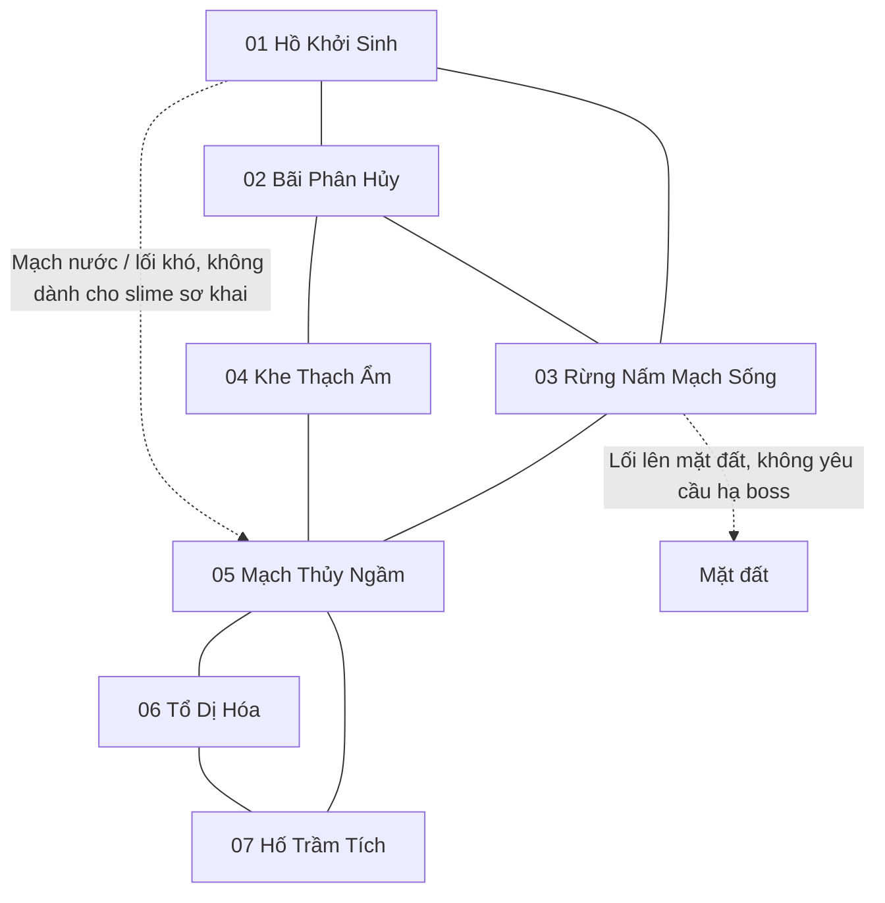

# PROJECT EVOLVE — UNDERROOT WORLD DESIGN HANDOFF

> **Tài liệu bàn giao thiết kế thế giới / Living World**  
> **Phiên bản tổng hợp:** 1.2 — 2026-11-17  
> **Phạm vi:** Hạ Giới Cổ Rễ (thế giới ngầm đầu game), hệ sinh thái sống, lịch sử môi trường, sinh tồn và yêu cầu tối ưu  
> **Trạng thái:** Tài liệu bàn giao để tích hợp dự án; **không đồng nghĩa mọi thông số đã được duyệt**, không phải xác nhận đã triển khai trong Unity.  
> **Nguồn:** Các quyết định và thảo luận concept PROJECT EVOLVE đến Living World v1.2. `docs/BESTIARY.md` là **tài liệu tham khảo**, không phải ràng buộc bắt buộc về sinh vật/lore.  
> **GitHub:** Chưa thực hiện chỉnh sửa hoặc commit repository khi tạo tài liệu này.

---

## 0. Cách đọc và mức độ quyết định

Để tránh nhầm concept với yêu cầu đã được chốt, tài liệu dùng các nhãn:

- **[ĐÃ CHỐT]**: Yêu cầu được người dùng trực tiếp xác định trong cuộc thảo luận.
- **[ĐỊNH HƯỚNG]**: Mục tiêu thiết kế được người dùng thể hiện rõ, nhưng cách hiện thực có thể điều chỉnh.
- **[ĐỀ XUẤT]**: Ý tưởng do quá trình thiết kế đưa ra; cần duyệt trước khi khóa thông số/triển khai.
- **[CẦN KIỂM CHỨNG]**: Chỉ tiêu kỹ thuật hoặc cân bằng phải thử trong Unity và multiplayer.

**Nguyên tắc áp dụng:** Nếu thông số bản nháp xung đột với yêu cầu đã chốt hoặc hệ gameplay của dự án, ưu tiên quyết định mới nhất của người dùng và thiết kế gameplay đang được duy trì trong dự án. Không tự động sửa tài liệu dự án khác chỉ vì đọc file bàn giao này.

---

## 1. Tuyên ngôn thế giới

**[ĐỊNH HƯỚNG]** PROJECT EVOLVE không xây một bản đồ để người chơi đến khám phá theo tuyến nhiệm vụ. Đây là một **hệ sinh thái có lịch sử, quy luật và nhịp sống riêng**, tồn tại trước khi người chơi sinh ra. Slime của người chơi chỉ là một sinh vật mới tham gia chuỗi thức ăn.

Hệ quả thiết kế:

1. **Sinh tồn khắc nghiệt hơn phiêu lưu khám phá.** Thức ăn, nơi trú, rủi ro săn mồi, thương tích và cạnh tranh tài nguyên là động lực di chuyển; khám phá là kết quả của nhu cầu sống sót.
2. **Thế giới không xoay quanh người chơi.** Sinh vật kiếm ăn, sinh sản, chết, tranh lãnh thổ, di cư; tài nguyên biến động dù không có người chơi trong vùng.
3. **Mỗi địa danh có quá khứ và hiện tại.** Vết nước cổ, tổ bỏ hoang, xương, lớp trầm tích, nấm mọc lại, dấu săn mồi kể chuyện bằng môi trường.
4. **Nguy hiểm có nguyên nhân và tín hiệu.** Một sinh vật B tiến vào gần hồ vì đang săn hoặc thiếu thức ăn, không phải xuất hiện vô cớ ngay sau lưng người chơi.
5. **Thế giới phải tối ưu và ổn định.** Độ sâu sinh thái được mô phỏng bằng nhiều cấp chi tiết thay vì hàng nghìn AI vật lý chạy liên tục.

**Tôn chỉ:** *Thế giới tiếp tục sống ngay cả khi người chơi không nhìn thấy nó; nhưng hệ thống chỉ dùng tài nguyên xử lý cần thiết để duy trì tính nhất quán đó.*

---

## 2. Các quyết định cứng và giới hạn nội dung

| Hạng mục | Quy định / trạng thái |
|---|---|
| Hình thái hệ hang | **[ĐÃ CHỐT]** Kết hợp đại hang rộng/thoáng, hành lang hẹp, sông ngầm, nhiều tuyến vòng; **không** biến thành dungeon tuyến tính. |
| Hồ Khởi Sinh | **[ĐÃ CHỐT]** Khu lõi **120 × 120 m**; hồ chủ yếu nước nông, có vài túi nước sâu; địa hình **mở và thoáng** trong khu vực trung tâm, không phải mê cung dày đặc. |
| Bầu không khí | **[ĐÃ CHỐT]** Hồ huyền bí dưới hệ rễ cổ thụ; càng ra vùng thoáng/cửa hang càng tươi sáng, nhiều ánh sáng tự nhiên. |
| Thời gian ở thế giới ngầm | **[ĐỊNH HƯỚNG]** Người chơi ở đây lâu để sinh tồn và tìm hiểu các quần xã, không chỉ xuất hiện rồi chạy ra mặt đất. |
| Sinh vật và nguồn cơ quan trong thế giới ngầm | **[ĐÃ CHỐT]** Chỉ có **tier D, C, B**, không có sinh vật/cơ quan A hoặc S ở khu ngầm đầu game. |
| Tier D | **[ĐÃ CHỐT]** Thường vô hại, ở đáy chuỗi thức ăn; nguồn dinh dưỡng của nhiều loài khác. |
| Tier C | **[ĐÃ CHỐT]** Sinh vật nhỏ; cơ quan bậc thấp cho chức năng nền tảng như nhìn, ngửi, cảm nhận, vận động, hấp thụ — không mở kỹ năng chiến đấu chủ động như tier B. |
| Tier B | **[ĐÃ CHỐT]** Nhóm sinh vật nguy hiểm nhất thông thường ở thế giới ngầm; có săn mồi, lãnh thổ, cơ quan chuyên hóa. |
| Boss | **[ĐÃ CHỐT]** **Boss bậc B dạng bầy đàn biến dị**. Boss là phân loại encounter, **không đồng nghĩa tier A/S**; chưa khóa thiết kế ngoại hình/phase chính thức. |
| Sinh tồn | **[ĐỊNH HƯỚNG]** Khắc nghiệt, lựa chọn sai có hậu quả; nhưng mối nguy phải được báo hiệu và có cách ứng phó hợp lý. |
| Bản đồ sống | **[ĐÃ CHỐT VỀ TINH THẦN]** Quần xã có chuỗi thức ăn, dấu tích thời gian, câu chuyện môi trường và biến đổi tự nhiên. |
| Hiệu năng | **[ĐÃ CHỐT VỀ YÊU CẦU]** Tối ưu để tránh lag, giật, lỗi khi hệ thống lớn; hiệu năng và tính nhất quán co-op là yêu cầu kiến trúc, không phải khâu sửa sau. |
| Repository | **[ĐÃ CHỐT TRONG GIAI ĐOẠN CONCEPT]** Không tự cập nhật GitHub cho tới khi người dùng duyệt và yêu cầu thực hiện. |

### 2.1. Ghi chú liên quan đến hệ tiến hóa (không phải trọng tâm tài liệu)

- **[ĐÃ CHỐT]** Slime không gắn nguyên cơ quan lấy từ quái lên thân; slime **dùng chính chất nhầy của mình mô phỏng cấu trúc và chức năng** cơ quan đã học, hình thành các chi/bộ phận liền mạch với cơ thể.
- **[ĐÃ CHỐT]** Có hướng tiến hóa **về chất** bên cạnh cơ quan/hình thái; phần chi tiết về gel/vật liệu, phân bổ sinh khối, Morph Stability đang **tạm gác** để ưu tiên world design. **Không** tự xem các công thức hay loại gel trong concept là thông số đã duyệt.
- **[BỐI CẢNH GAMEPLAY ĐANG CÓ]** Slime ban đầu không mắt, miệng, tay, chân; cảm nhận/nhìn gần trong môi trường đen trắng, rung động là phương tiện quan trọng. Hệ BIS (độ nguyên vẹn và tổn thương cơ quan), nguyên lý bản thiết kế cơ quan đã nghiên cứu được giữ lại, và lối chơi co-op cần được tôn trọng. Kiểm chứng các giá trị chính xác với tài liệu/cấu hình thực tế của dự án trước khi code.

---

## 3. Quy hoạch không gian thế giới ngầm

### 3.1. Quy mô [ĐỀ XUẤT]

- **Phạm vi bao:** xấp xỉ **600 × 600 m**; không phải 360.000 m² nền bằng đi lại được.
- **Độ chênh địa hình:** khoảng **150 m**; các đại hang có thể nằm chồng lên nhau ở những cao độ khác nhau.
- **Tỷ lệ vùng có thể khám phá:** khoảng **35–45%** diện tích bao khi xét các tầng chồng lấn; *ước lượng để quy hoạch, cần đo trong blockout*.
- **Hồ Khởi Sinh 120 × 120 m:** đây là thông số đã chốt về khu lõi; thiết kế phần còn lại cần bảo đảm tốc độ di chuyển slime sơ khai không gây quá nhiều thời gian chạy bộ vô nghĩa.

### 3.2. Bảy quần xã [ĐỀ XUẤT BỐ CỤC / TÊN]

> Bảy khu dưới đây là **khung đề xuất cho thiết kế tiếp theo**, chưa phải danh sách địa danh bất biến. Các quần xã phải chuyển tiếp tự nhiên, có vùng giao thoa và có thể chồng theo cao độ.

| ID | Quần xã | Khoảng nền tương đối | Quy mô quy hoạch | Nguồn sống | Mối nguy chính |
|---|---|---:|---|---|---|
| 01 | **Hồ Khởi Sinh** | -5 đến +5 m | **Lõi 120 × 120 m** | Rong, màng sinh học, mùn ẩm, sinh vật D | Cạnh tranh thức ăn, sinh vật C, nước dâng |
| 02 | **Bãi Phân Hủy** | -12 đến -4 m | ~110 × 90 m | Rễ mục, lá mục, xác hữu cơ, nấm | Tranh nguồn sống, kẻ săn B ghé qua |
| 03 | **Rừng Nấm Mạch Sống** | -25 đến -8 m | ~180 × 150 m | Nấm, sinh vật cộng sinh, côn trùng | Bào tử, phục kích, tranh lãnh thổ B |
| 04 | **Khe Thạch Ẩm** | -50 đến -20 m | ~140 × 100 m | Mùn trong khe, sinh vật bám đá, nước rỉ | Rơi/trượt, mắc kẹt, săn mồi tại nút thắt |
| 05 | **Mạch Thủy Ngầm** | -85 đến -40 m | ~170 × 130 m | Sinh vật nước, thức ăn dạt theo dòng | Dòng cuốn, ngập, kẻ săn theo rung động nước |
| 06 | **Tổ Dị Hóa** | -115 đến -80 m | ~110 × 100 m | Mạng nấm, tích trữ, tuyến kiếm ăn của bầy | Báo động dây chuyền, bao vây, boss B |
| 07 | **Hố Trầm Tích** | -145 đến -105 m | ~120 × 80 m | Xác hữu cơ, khoáng, bùn giàu mùn cục bộ | Sa bùn, nước dâng, thiếu thức ăn ổn định |

**Lưu ý vật lý/địa lý:** Cao độ trên là giá trị thiết kế sơ bộ, không bắt buộc bảo đảm mặt sông luôn đi theo trục địa hình đơn giản. Khi dựng địa hình phải kiểm tra *từng nguồn nước, độ dốc và đường thoát* để thủy văn hợp lý.

### 3.3. Sơ đồ kết nối logic

**Ba vòng lưu thông chính**:

1. `01 → 02 → 03 → 01`: tìm kiếm dinh dưỡng, nhận diện nguy hiểm, trở về nơi trú.
2. `02 → 04 → 05 → 03 → 02`: chuyến săn xa, quyết định giữa đường rễ/nấm, khe đá và bờ sông.
3. `05 → 06 → 07 → 05`: tuyến nguy hiểm, phục kích và áp lực lãnh thổ bầy biến dị.

**[ĐỀ XUẤT]** Lối lên mặt đất có thể tìm thấy từ gần Rừng Nấm, **không cần giết boss**; ngoài mặt đất vẫn phải nguy hiểm để việc ở lại hang có giá trị sinh tồn. Cơ chế chính xác của lối lên chưa được người dùng chốt.

### 3.4. Nguyên tắc thiết kế tuyến

- Kết hợp **hang mở** (tầm hoạt động rộng), **hành lang hẹp** (khó né nhưng có lối trốn), **khe cơ thể nhỏ** (trú khỏi thú lớn), **tuyến bờ sông** và **đường vòng cao độ**.
- Tránh một nút thắt duy nhất bắt buộc đi qua lãnh thổ sinh vật B/boss để trở về khu sống.
- Có lối cơ bản cho slime nguyên thủy trong vùng D/C; tuyến chuyên dụng bơi/leo/đào là lựa chọn/đường tắt, không phải khóa toàn bộ hệ sinh thái.
- Các điểm cao nhìn xuống hang thấp, đường vòng hiện ra nhờ dấu vết và cấu trúc địa hình; tránh hình học chỉ tạo vách đẹp nhưng không giúp định hướng.
- Với tầm cảm nhận ngắn của slime ban đầu, định hướng nhờ **dòng nước, mặt đất, âm vang, rung động, mật độ sinh vật**, không lệ thuộc màu sắc/ánh sáng.

---

## 4. Thiết kế Hồ Khởi Sinh — vùng khởi đầu sống được lâu dài

**[ĐÃ CHỐT]** Khu lõi **120 × 120 m**, **mở và thoáng**, bên dưới hệ rễ cây khổng lồ; **nước nông chiếm phần chính**, có vài hốc nước sâu.

### 4.1. Các vi sinh cảnh [ĐỀ XUẤT]

- **Vũng Sinh Mệnh / Đầm Sinh Mệnh:** điểm slime xuất hiện; nước nông, rong và màng sinh học, đảo bùn thấp, sinh vật D ăn dưỡng chất.
- **Chân Rễ Cổ Thụ:** khối rễ lớn ở rìa, tạo bóng tối và các hốc trú; hạn chế biến thành mê cung đóng kín.
- **Bãi Mùn Rễ:** nơi cạnh tranh thức ăn, xác thực vật, sinh vật phân hủy và con mồi nhỏ.
- **Vườn Bào Tử / Đồng Rêu Non:** nơi tương tác với sinh vật C và các cụm nấm; bào tử tác động giác quan cần có cảnh báo.
- **Khe Thủy Mạch:** nước nông chảy ra từ hồ, kèm khoảng **hai hốc sâu** *(đề xuất, chưa khóa số lượng)*, bờ trên cạn luôn có đường vòng.
- **Rìa Săn Mồi:** vùng chuyển sang hệ hang khác; sinh vật B có thể đi săn vào nhưng không sinh ngay tại điểm xuất hiện.

### 4.2. Quy tắc sinh tồn

- Vùng spawn có nguồn dinh dưỡng ban đầu đủ để người chơi học cách tồn tại nhưng không đủ để toàn bộ nhóm 4–8 người khai thác mãi không cần di chuyển.
- Kẻ săn B có thể **tự nhiên đi vào** do điều kiện sinh thái; không được spawn vô cớ ngay cạnh slime mới sinh.
- Khe rễ nhỏ giúp né sinh vật lớn nhưng có thể trở thành bất tiện khi slime tăng kích thước.
- Mục tiêu không phải đẩy người chơi ra khỏi hang trong 10–15 phút; họ cần có thể săn, phục hồi, lựa chọn nơi trú và quan sát các quần xã trong thời gian dài.
- Giữ các điểm spawn co-op hợp lệ, tránh chồng collider; cần kiểm tra vị trí 4–8 slime có thể liên lạc/gặp nhau với tầm cảm nhận đầu game.

---

## 5. Sinh thái sống: quần thể, chuỗi thức ăn và lãnh thổ

### 5.1. Mô hình dòng năng lượng

`Mùn / nấm / rong / vi sinh vật → Sinh vật D → Sinh vật C → Kẻ săn B → xác / chất thải → chu trình phân hủy`

Đây là sơ đồ đơn giản; **không** nhất thiết mọi loài chỉ ăn tier thấp hơn. Quần thể boss B là một hệ xã hội/biến dị đặc biệt, **không** phải tier cao hơn B.

**Tier D:** thường vô hại, kiếm ăn/phân hủy, tránh nguy hiểm và sinh sản; là nền quần xã.  
**Tier C:** sinh vật nhỏ có kiếm ăn, di chuyển, trốn tránh, đôi khi tranh thức ăn/săn D.  
**Tier B:** kẻ săn mồi với hốc trú, vùng săn, hành vi tuần tra, có thể mở rộng lãnh thổ khi khan hiếm mồi.

### 5.2. Vòng đời và quan hệ sinh thái [ĐỊNH HƯỚNG]

Đối với mỗi loài bản địa, thiết kế tối thiểu:

1. Nguồn thức ăn và nước.
2. Nơi trú/ngủ, tổ hoặc khu sinh sản.
3. Vùng hoạt động thường xuyên, tuyến di cư/kiếm ăn.
4. Kẻ săn nó và con mồi của nó.
5. Phản ứng với rung động, mùi, ánh sáng, nước, bào tử và xác chết tùy loài.
6. Điều kiện sinh sản, chết, giảm quần thể hoặc rời vùng.
7. Vết tích có thể để lại (hang đào, phân, dấu cào, xác, vỏ lột, thực vật bị ăn).

**Không** thiết kế sinh vật chỉ như một điểm spawn + thanh HP + loot table.

### 5.3. Ví dụ sinh vật đang là concept [ĐỀ XUẤT]

| Tier | Loài mẫu | Sinh cảnh / hành vi | Trạng thái |
|---|---|---|---|
| D | Vi Nhầy Phù Du | Sống cạnh mảng dinh dưỡng, thường tụ tập | Đề xuất tên/đặc điểm |
| D | Ấu Trùng Mùn | Ăn xác thực vật, chui trong bùn | Đề xuất |
| D | Giọt Trôi | Theo dòng nước nông, ăn hạt hữu cơ | Đề xuất |
| C | Bọ Đào Mùn | Đào đất, tìm rễ mục, nhạy rung động | Đề xuất |
| C | Bọ Nhảy Cỏ | Sinh vật nhỏ, bỏ chạy, tham chiếu prototype/bestiary | Tham chiếu, cần xác nhận môi trường hang phù hợp |
| C | Ốc Rễ Xoắn | Bám rễ, ăn mùn, ẩn trong vỏ | Đề xuất |
| B | Bọ Móc Rễ | Phục kích từ gốc rễ/địa hình | Đề xuất |
| B | Kỳ Nhông Hàm Đá | Săn gần nước, theo rung động, có lãnh thổ | Đề xuất |
| Boss B | Quần Thể Dị Hóa | Bầy biến dị, giao tiếp, báo động/hợp thể | **Kiểu boss đã chốt**; tên/cơ chế cụ thể còn đề xuất |

Các loài trong `docs/BESTIARY.md` chỉ cung cấp cảm hứng; **không** ép mọi loài trong tài liệu đó vào bản đồ.

### 5.4. Boss B — Quần thể biến dị

**[ĐÃ CHỐT]** Boss là **bầy đàn biến dị tier B**. Các hướng thiết kế **[ĐỀ XUẤT]**:

- Tổ có các phân khu: kiếm ăn → bảo vệ → sinh sản/hợp thể.
- Bầy có đường vận chuyển thức ăn, cá thể trinh sát và tín hiệu báo động; không chỉ tồn tại khi người chơi vào boss room.
- Quần thể có thể mở rộng lãnh thổ hoặc bị đẩy lùi theo nguồn sống, tác động lên các loài bản địa.
- Encounter có thể gồm tấn công theo đàn, hợp thể trung tâm và phân rã/tái tập hợp; **chưa khóa phase**.
- Tấn công cơ quan liên kết/chi có thể áp dụng BIS; cơ quan rơi **không vượt tier B**.
- Không buộc đánh boss để mở đường lên mặt đất, trừ khi người dùng duyệt khác.

---

## 6. Thời gian, lịch sử và kể chuyện bằng môi trường

### 6.1. Quy tắc lịch sử tự nhiên

**[ĐỊNH HƯỚNG]** Thế giới có lịch sử trước khi slime được sinh ra, được thể hiện bằng trầm tích, rễ hóa gỗ, hang sụp, xác cũ, nấm thế hệ mới và tổ bỏ hoang. Không mặc định có nền văn minh cổ, nhân loại hoặc NPC kể lore.

**Bốn thời kỳ minh họa [ĐỀ XUẤT CHƯA CHỐT LORE]:**

1. **Rễ Cổ Xâm Thực:** rễ cổ xuyên khe đá, hình thành vòm và dẫn nước.
2. **Đại Thủy Ngầm:** các thời kỳ nước dâng lớn tạo bãi sỏi, vết nước cũ, hồ và trầm tích.
3. **Rừng Nấm Hưng Thịnh:** hệ nấm mở rộng, thay đổi cấu trúc quần xã.
4. **Quần Thể Dị Hóa Trỗi Dậy:** một quần thể biến dị dần chiếm tổ và đường kiếm ăn của các loài khác.

Không coi bốn thời kỳ là *canon* trước khi duyệt riêng.

### 6.2. Ba loại dấu tích

| Loại | Ví dụ | Xử lý đề xuất |
|---|---|---|
| **Ngắn hạn** | Dấu chân, bùn xới, cây nấm gãy, vết kéo mồi | Có TTL/giới hạn đối tượng; có thể phục vụ theo dấu |
| **Trung hạn** | Tổ bỏ hoang, sinh cảnh bị ăn trụi, xác phân hủy | Lưu thay đổi theo khu/tổ, đơn giản hóa model |
| **Dài hạn** | Hóa thạch, rễ hóa đá, hang sụp lâu đời, gốc nấm cổ | Chủ yếu level art cố định; những thay đổi đặc biệt cần persistence |

### 6.3. Câu chuyện phát sinh, không phải quest đóng hộp

- **Hang mất chủ:** kẻ săn mồi B chết, xác thu hút sinh vật ăn xác, sau đó một loài khác chiếm hốc trú.
- **Dòng sông đổi dòng/mực:** thức ăn và xác bị cuốn đi; sinh vật D dạt lên nơi cao, sinh vật C/B đi theo.
- **Sự xâm lấn của Dị Hóa:** tuyến vận chuyển mở rộng, tổ bản địa bị bỏ, người chơi thấy dấu hiệu trước khi gặp boss.
- **Bãi mùn bị khai thác quá mức:** sinh vật D giảm, C di cư, B tìm đường săn mới.

Một địa điểm phải có *quá khứ → trạng thái hiện tại → khả năng biến đổi tương lai*, chứ không chỉ có danh sách props.

---

## 7. Nước, môi trường và tình huống sinh tồn

### 7.1. Thủy văn chung [ĐỀ XUẤT]

`Nước thấm từ mặt đất → Hồ Khởi Sinh → nhánh sông xuống Mạch Thủy → Hố Trầm Tích / khe thoát sâu`.

Ba chế độ:

- **Nước thấp:** lộ bãi sỏi và đường ven bờ; điểm nước còn lại tập trung sinh vật.
- **Bình thường:** các tuyến ổn định như blockout cơ bản.
- **Nước dâng:** lối thấp có thể bị ngập, dòng mạnh, sinh vật rời vùng thấp, lối cao trở nên quan trọng.

**Bắt buộc có cảnh báo** qua âm nước, chuyển động nước, nền rung, hành vi sinh vật trước sự kiện lớn. Không tạo tình huống người chơi chết chỉ vì một cờ sự kiện bất ngờ không thể nhận biết.

### 7.2. Các mối nguy đầu game

- Đói và thiếu tài nguyên cục bộ.
- Sinh vật D bị săn cạn ở một vùng; tranh thức ăn giữa nhiều loài.
- Kẻ săn C/B phục kích, tuần tra hoặc đi lạc do điều kiện sinh thái.
- Dòng nước, ngập, khe đá, sa bùn, địa hình trơn.
- Bào tử gây nhiễu cảm giác (tác động và đối sách cụ thể cần cân bằng).
- Tổ quần thể biến dị phát báo động hoặc mở rộng vùng hoạt động.

**Nguyên tắc cân bằng:** Áp lực tạo ra quyết định sinh tồn, không phải thanh đói giảm nhanh vô lý khiến người chơi không thể làm gì khác.

---

## 8. Hệ thống nơi trú, tổ và tranh lãnh thổ

**[ĐỊNH HƯỚNG]** Tổ và nơi trú là một phần sinh tồn quan trọng: tránh kẻ săn, hồi phục, cất tài nguyên, tái tạo cơ quan, lên kế hoạch chuyến đi săn co-op. Thiết kế xây tổ cụ thể chưa chốt.

| Vị trí | Lợi thế | Rủi ro |
|---|---|---|
| Hốc rễ Hồ Khởi Sinh | Gần nguồn nước và thức ăn D | Dễ cạnh tranh nguồn sống |
| Hang ven Bãi Phân Hủy | Nhiều dinh dưỡng | Thu hút thú săn/ăn xác |
| Gờ cao Khe Thạch | Tránh ngập, khó bị tấn công | Vận chuyển thức ăn khó |
| Bờ cao Mạch Thủy | Tiếp cận nguồn sinh vật thủy sinh | Thú săn dưới nước và lũ |
| Hốc khô Rừng Nấm | Có chỗ che khuất | Bào tử và phục kích |

Không có chỗ nào tuyệt đối an toàn. Nếu người chơi xây ở đường săn hoặc vùng kiếm ăn của sinh vật B, nguy cơ phát hiện tăng một cách có quy luật.

---

## 9. Kiến trúc hiệu năng bắt buộc

### 9.1. Mục tiêu

**[ĐÃ CHỐT VỀ YÊU CẦU]** Thế giới phải sống động nhưng **không lag/giật/lỗi khi mở rộng**, bao gồm 4–8 người chơi co-op. Không thiết kế hệ sinh thái dưới giả định tất cả quần xã đều mô phỏng vật lý và AI cá thể toàn thời gian.

### 9.2. Mô phỏng nhiều cấp (Simulation LOD)

| Cấp | Điều kiện | Mô phỏng |
|---|---|---|
| **L0 — Active / Full** | Gần ít nhất một người chơi, đang chiến đấu/tương tác | AI cá thể, di chuyển, detection, chiến đấu, collider gameplay, animation |
| **L1 — Reduced / Group** | Ở gần vùng hoạt động hoặc cần ảnh hưởng kế cận | Đại diện nhóm/quần thể, quyết định theo chu kỳ, hạn chế pathfinding và animation |
| **L2 — Statistical / Dormant** | Quần xã không có người chơi | Số quần thể, thức ăn, xác/trạng thái tổ, mức chiếm lãnh thổ, tiến triển sinh thái theo chu kỳ |

**Nguyên tắc bắt buộc:** Chuyển từ L2/L1 sang L0 phải giữ tính nhất quán với những việc người chơi đã làm hoặc tận mắt chứng kiến. Không tự tái sinh lại tổ đã bị phá hủy, resurrect boss hay làm mất tài nguyên người chơi đã thu nếu chưa có quá trình hồi phục thật.

### 9.3. Tách ba lớp dữ liệu/hoạt động

1. **World State / Data:** ID quần xã; population theo loài; food stock; tổ; lãnh thổ; lịch sử sự kiện; dấu tích bền vững; seed ngẫu nhiên có kiểm soát; dữ liệu save.
2. **Simulation:** Các quyết định săn/ăn/sinh sản/chết/di cư, dòng nước, cập nhật quần thể và combat.
3. **Presentation:** Mesh, VFX, SFX, animation, decals, particle, ánh sáng, vật trang trí.

Không buộc một GameObject 3D luôn tồn tại chỉ để giữ một con số quần thể trong World State.

### 9.4. Tối ưu theo hạng mục

| Hạng mục | Cách thực hiện |
|---|---|
| **AI** | Giới hạn AI full gần người chơi, cập nhật không đồng thời mỗi frame; dùng state machine và LOD quần thể |
| **World streaming** | Chia scene/chunk theo hang + vùng chuyển tiếp; tải bất đồng bộ, chuẩn bị vùng lân cận, tránh dỡ scene khi người chơi còn bên trong |
| **Mesh môi trường** | Rễ modular, mesh dùng lại, LOD, material chung, static batching/instancing khi phù hợp |
| **Culling** | Frustum + occlusion culling ở những hang bị che khuất; kiểm thử tương thích additive scenes |
| **VFX** | Pooling; giảm bào tử, sương và particle từ xa; giới hạn overdraw vùng nước/nấm phát quang |
| **Nước** | Shader URP + vùng trigger dòng chảy/độ sâu; không dùng fluid simulation toàn cảnh |
| **Xác chết** | Xác tương tác → representation đơn giản → dinh dưỡng/dấu tích; không để Rigidbody vô thời hạn |
| **Dấu chân, vết cào** | Pooling, TTL, giới hạn số lượng; lưu bền vững chỉ những dấu tích quan trọng |
| **Sinh thái xa** | Cập nhật thống kê theo quần xã với bước thời gian lớn, tránh chạy AI/NAV vật lý |
| **Persistence** | Chỉ lưu state cần thiết; ID ổn định, phiên bản hóa save, định kỳ snapshot/checkpoint |
| **Co-op** | Server/host authoritative cho world state, combat và loot; interest management cho network objects |

### 9.5. Ngân sách đo thử [CẦN KIỂM CHỨNG]

> **Không phải cam kết hiệu năng.** Các số sau là mục tiêu sơ bộ từ thảo luận v1.2, cần đo trên build thực tế, đặc biệt khi host chơi và 8 người ở các hang khác nhau.

| Chỉ tiêu | Mốc thử nghiệm sơ bộ |
|---|---:|
| FPS 1080p | Phấn đấu 60 FPS |
| Thời gian một frame ở 60 FPS | ~16,7 ms tổng ngân sách CPU/GPU |
| AI full đang hoạt động | Khoảng 20–35 cá thể tùy độ phức tạp |
| Sinh vật/nhóm mô phỏng giảm chi tiết | Khoảng 50–100 đại diện/nhóm tùy thiết kế |
| Quần xã mô phỏng thống kê | Cả 7 khu; không tải mọi actor 3D |
| Nhịp cập nhật sinh thái xa | Khoảng 5–15 giây hoặc theo sự kiện |
| Xác tương tác gần vùng hoạt động | Khoảng 10–20, có pooling/chuyển dạng |
| Quy mô co-op mục tiêu | 4–8 người |

Độ mượt không chỉ là FPS trung bình: kiểm tra **1% low / spike**, độ trễ mạng, RAM/VRAM, GC allocation, thời gian tải scene và lỗi trạng thái sau reconnect/load.

### 9.6. Bảo vệ khi quá tải

Thứ tự giảm tải gợi ý:

1. Giảm tần suất cập nhật AI ở xa và tính sinh thái không cấp bách.
2. Cắt giảm VFX, decal, âm thanh và hoạt ảnh không thiết yếu.
3. Giới hạn lượng spawn/restore AI từ dữ liệu thống kê trong mỗi frame.
4. Tải và dỡ khu vực theo budget mỗi frame, dùng object pool.
5. Tránh giải phóng/khởi tạo hàng loạt dẫn tới GC spike.

**Không được bỏ qua** kiểm tra sát thương, BIS, trạng thái người chơi, collision quan trọng, hành vi kẻ săn đang giao chiến, số mạng và kết quả loot chỉ để cải thiện FPS.

### 9.7. Multiplayer / save correctness

- Mỗi vùng phải được kích hoạt theo **tập hợp vị trí của tất cả người chơi**, không chỉ vị trí host.
- Server/host quyết định quần thể, tài nguyên, AI có gameplay, boss, loot và các thay đổi lâu dài.
- Client không nhận vị trí chi tiết của sinh vật ở quần xã xa, chỉ nhận trạng thái cần hiển thị/tương tác.
- Sinh vật đang truy đuổi qua biên giới hai khu không được biến mất tùy tiện khi streaming.
- Khi khôi phục save phải duy trì trạng thái tổ, lãnh thổ, sự kiện đã xảy ra và thay đổi tài nguyên đáng kể.
- Với host rời game, cần quy định cụ thể là kết thúc phiên hay host migration; **chưa chốt**, không ngầm giả định hỗ trợ host migration.

---

## 10. Bộ kiểm thử bắt buộc trước khi mở rộng thế giới

### 10.1. Test sinh thái và tính nhất quán

- [ ] Một khu có nhiều sinh vật D; C ăn D, B săn C theo quy luật, không cần người chơi điều khiển.
- [ ] Người chơi khai thác D liên tục, mức dinh dưỡng/quần thể và đường săn thay đổi theo thời gian.
- [ ] Một hang có sinh vật B chết; xác phân hủy, vùng lãnh thổ có thể bị chiếm lại hợp lý.
- [ ] Trạng thái quần xã xa được cập nhật, khi quay lại không có sinh vật/tổ/tài nguyên xuất hiện vô lý.
- [ ] Dấu tích cổ ổn định, dấu tích ngắn hạn bị giới hạn số lượng và biến mất đúng quy luật.
- [ ] Nước dâng làm thay đổi sinh cảnh và lối đi có cảnh báo, không kẹt toàn bộ người chơi.
- [ ] Boss B báo động bầy đàn, gọi nhóm và thay đổi state không dẫn đến nhân bản quái vô hạn.

### 10.2. Test hiệu năng, streaming, multiplayer

- [ ] 1 người đi từ Hồ Khởi Sinh tới Bãi Phân Hủy và Rừng Nấm không có freeze bất thường.
- [ ] 8 người ở cùng một hang với nhiều sinh vật D/C.
- [ ] 8 người tản ra nhiều quần xã; host CPU, RAM, băng thông trong ngân sách.
- [ ] Sinh vật B truy đuổi qua hai scene/chunk không mất mục tiêu hoặc duplicate.
- [ ] Chuyển L0↔L1↔L2 liên tục không lặp spawn, không hồi sinh tổ đã bị phá.
- [ ] Nhiều xác + cơ quan + loot phát sinh cùng lúc không làm treo frame hoặc sai quyền sở hữu.
- [ ] Boss B với nhiều cá thể và mạng quần thể không làm bùng nổ số NetworkObjects.
- [ ] Save/load trong nhiều trạng thái nước, boss, tổ và người chơi không bị mất dữ liệu.
- [ ] Chơi thời gian dài: đo leak, GC spikes, AI không còn tham chiếu, pooling, bộ nhớ.
- [ ] Test kết nối lại/rời phiên và chính sách host disconnect được xác định rõ.

### 10.3. Tiêu chí hoàn thành một quần xã

Một khu chỉ coi là *đủ điều kiện mở rộng* khi:

- Có lý do địa chất/nguồn nước/thức ăn rõ ràng.
- Có ít nhất một dòng năng lượng `nguồn sống → sinh vật → xác/phân hủy` hoạt động được.
- Sinh vật có hoạt động độc lập tối thiểu với người chơi.
- Có rủi ro và đường ứng phó hợp lý.
- Có ít nhất một loại dấu tích lịch sử và một thay đổi có thể diễn ra khi người chơi vắng mặt.
- Mô phỏng có LOD, streaming và lưu trạng thái ổn định.
- Đạt ngân sách hiệu năng trong bài test thực tế, không chỉ trong scene rỗng.

---

## 11. Thứ tự triển khai khuyến nghị

### Phase A — Vertical slice đầu tiên [ƯU TIÊN CAO]

**Phạm vi:** Hồ Khởi Sinh **120 × 120 m** và một phần Bãi Phân Hủy.

1. Blockout địa hình hang mở, bờ nước nông, rễ lớn, khu ẩn nấp và lối kết nối.
2. Thêm luồng tài nguyên và ít nhất 1 loài D + 1 loài C có hành vi kiếm ăn/trốn tránh.
3. Thêm 1 mối đe dọa B có lãnh thổ và dấu hiệu cảnh báo.
4. Thêm một loại xác phân hủy, một loại dấu tích ngắn hạn, một dấu tích địa chất/lịch sử cố định.
5. Implement `WorldState` cho khu, mô phỏng L0/L1/L2 và thử rời-về khu sau một khoảng thời gian.
6. Kiểm thử co-op, streaming, save/load và FPS/GC với số lượng sinh vật thực tế.

**Kết quả kỳ vọng:** Một khu vực đã có áp lực sinh tồn và lịch sử tự phát, không chỉ đẹp về cảnh quan.

### Phase B — Mở rộng quần xã và đường vòng

Bãi Phân Hủy hoàn chỉnh → Rừng Nấm → Khe Thạch → Mạch Thủy. Kiểm chứng quan hệ sinh vật liên khu, dòng nước và đường thay thế khi khu vực bị chiếm/ngập.

### Phase C — Sinh thái vùng sâu và boss

Hố Trầm Tích, tổ bầy biến dị, báo động tập thể, boss B và hậu quả lâu dài khi quần thể bị ảnh hưởng.

### Phase D — Polish sống động

Nâng chất lượng dấu tích nhiều thế hệ, âm thanh sinh thái, hành vi nền và biến đổi trạng thái cảnh quan; **chỉ sau khi performance budget đạt yêu cầu**.

---

## 12. Danh sách câu hỏi mở / chưa khóa

1. **Bản đồ:** Phạm vi 600 × 600 m và chiều sâu ~150 m có phù hợp tốc độ slime, thời gian hành trình và kỹ năng di chuyển không?
2. **Quần xã:** Tên và ranh giới chính thức của bảy địa bàn; có cần gộp hoặc thay khu nào không?
3. **Thoát hang:** Lối lên mặt đất có thể tới sớm, có đòi hỏi cơ quan vận động hoặc chỉ là rủi ro tự nhiên? Hiện mới là đề xuất không khóa bằng boss.
4. **Boss:** Ngoại hình, tổ chức bầy, cơ chế hợp thể, giai đoạn trận đánh; đã chốt tier B và tính chất bầy đàn biến dị, **chưa chốt chi tiết**.
5. **Population:** Tốc độ sinh sản, đói, chết, di cư, hồi phục tài nguyên và khả năng hệ sinh thái bị tuyệt chủng; cần cân bằng tránh soft-lock.
6. **Chu kỳ:** Có ngày đêm thực trong hang hay dùng chu kỳ độ ẩm/nước/thức ăn thay thế?
7. **Tổ:** Quyền sở hữu, xây dựng, bảo vệ, hồi phục, khả năng bị đột kích.
8. **Persistence:** Chu kỳ save, chính sách rollback/host disconnect, thời gian trôi qua khi server tắt.
9. **Hiệu năng:** Mức máy tối thiểu của người chơi, chế độ graphics, ngưỡng số actor/network thực tế.
10. **Evolution:** Tiến hóa vật chất đã được nêu nhưng **tạm gác**; chưa tích hợp công thức cân bằng vào World Design.
11. **Canon lore:** Các kỷ nguyên địa chất và lịch sử quần thể là ví dụ, cần duyệt trước khi ghi thành lore chính thức.

---

## 13. Gợi ý tích hợp vào repository

**Đường dẫn đề xuất:** `docs/world/UNDERROOT_WORLD_DESIGN.md` (hoặc vị trí tài liệu world design phù hợp cấu trúc repo).

Khi người dùng đồng ý cập nhật dự án:

1. Tạo tài liệu thiết kế thế giới từ file bàn giao này, giữ nhãn **ĐÃ CHỐT / ĐỀ XUẤT**.
2. Đối chiếu tài liệu gameplay hiện hành (`docs/GAME_DESIGN.md`, BIS và các file khác) để không ghi đè hệ thống đã duyệt.
3. Chỉ đưa địa danh, cơ chế và thông số chưa chốt vào mục *Proposals / Open Questions*, không ghi như yêu cầu code bắt buộc.
4. Tách phần kỹ thuật thành backlog: world streaming, simulation LOD, population model, persistence, co-op authority, performance benchmark.
5. Bắt đầu bằng **vertical slice Hồ Khởi Sinh + Bãi Phân Hủy**; kiểm chứng trước khi mở rộng 7 khu.

**Tài liệu này là sản phẩm bàn giao nội dung, không phải bằng chứng các hạng mục đã hoàn thành trong mã nguồn.**

---

### Tóm tắt một câu

**PROJECT EVOLVE cần một thế giới ngầm D/C/B sống động, lâu đời và khắc nghiệt, nơi slime của người chơi chỉ là một mắt xích mới trong quần xã — và toàn bộ sự sống đó phải được duy trì bằng kiến trúc mô phỏng nhiều cấp, streaming, lưu trạng thái cùng tối ưu co-op ngay từ đầu.**
